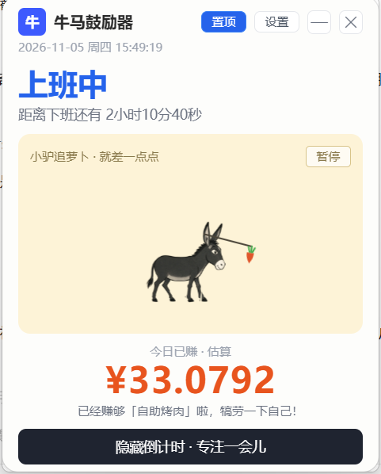

<div align="center">

# 🐴🥕 牛马鼓励器 NiuMaBooster

**看着钱一秒一秒进账，班都更有劲上了**

实时计薪悬浮窗 · 下班倒计时 · 小驴追萝卜动画 · 纯本地运行

[](https://github.com/YOUR_USERNAME/niuma-booster/releases)
[](LICENSE)
[](https://v2.tauri.app/)
[](https://vuejs.org/)



安装包仅 **~2 MB**，内存占用极低，Win10 / Win11 即装即用。

</div>

---

## ✨ 功能一览

| 功能 | 说明 |
|---|---|
| 💰 **实时计薪** | 超大金额字体每秒跳动，4 位小数，钱在肉眼可见地变多 |
| ⏰ **状态自动切换** | 还没上班 → 上班中 → 午休不计薪（金额冻结）→ 下班啦（停止涨钱）|
| 🐴 **小驴追萝卜** | 你就是那头驴，萝卜吊在钓竿上；工时进度越高，萝卜离嘴越近；四腿逐帧奔跑动画 |
| 🎯 **心愿进度** | 填个心愿（如「自助烤肉 ¥150」），攒够了提醒你犒劳自己 |
| ⏸️ **暂停 / 专注模式** | 摸鱼怕老板看？一键暂停计薪 / 隐藏倒计时只留动画 |
| 📊 **工时进度 + 本月累计** | 蓝色进度条 + 本月已赚总额，跨天自动结算沉淀 |
| 🖥️ **桌面悬浮** | 无边框透明窗口、始终置顶、不抢焦点、全窗拖拽、鼠标穿透可选 |
| 🫥 **系统托盘** | 关闭 = 缩进托盘；右键菜单：显示 / 隐藏 / 设置 / 取消穿透 / 退出 |
| 🚀 **开机自启** | 设置里勾一下，开机自动上岗 |
| 🔒 **纯本地** | 无网络请求、无数据上传，所有配置与收入记录只存在你自己电脑上 |

## 📦 下载安装

前往 [**Releases**](https://github.com/YOUR_USERNAME/niuma-booster/releases) 下载最新的
`NiuMaBooster_x.x.x_x64-setup.exe`，双击安装即可。

> 系统要求：Windows 10 / 11（自带 WebView2，缺失时安装器会自动补装）

首次启动请点右上角 **设置**，填入月薪、上下班时间、午休时间，金额立刻开始跳动。

## 🧮 计薪公式

```text
日薪           = 月薪 ÷ 每月计薪工作日（默认 21.75）
每秒收入       = 日薪 ÷（下班 − 上班 − 午休时长）
今日已赚       = 已有效工作秒数 × 每秒收入
工时进度       = 已有效工作时长 ÷ 每日有效总工时
心愿剩余时间   = max(0, 心愿目标价 − 今日已赚) ÷ 时薪
```

实现上不做累加计数，而是每 250ms 由「当前时间 + 配置」**全量推导**——
睡眠唤醒、掉帧、暂停恢复都不会产生误差累积。

## 🛠️ 本地开发

环境准备（一次性）：

1. **Node.js ≥ 18**
2. **Rust 工具链**：安装 [rustup](https://rustup.rs/)（Windows 选 `x86_64-pc-windows-msvc`），
   并安装 [Visual Studio Build Tools](https://visualstudio.microsoft.com/visual-cpp-buildtools/)
   （勾选「使用 C++ 的桌面开发」）

```bash
npm install            # 安装依赖
npm run tauri dev      # 启动调试（热更新）
npm run tauri build    # 打包 Windows 安装包（NSIS）
# 产物：src-tauri/target/release/bundle/nsis/*.exe
```

## 📁 项目结构

```
niuma-booster/
├── src/                          # 前端（Vue3 <script setup> + TS + TailwindCSS）
│   ├── App.vue                   # 主界面
│   ├── composables/useNiuma.ts   # ★ 核心：薪资计算引擎 + 持久化 + 暂停时钟
│   ├── components/
│   │   ├── DonkeySvg.vue         # 小驴追萝卜动画（含 8 帧腿部跑步动画）
│   │   └── SettingsModal.vue     # 设置面板
│   └── assets/                   # 驴插画素材与跑步帧
├── src-tauri/                    # Rust 侧（只做托盘/存储/窗口控制）
│   ├── src/lib.rs                # 托盘菜单、关闭=隐藏到托盘
│   ├── tauri.conf.json           # 无边框+透明+置顶+免焦点窗口配置
│   └── capabilities/default.json # 权限清单
└── .github/workflows/release.yml # 推 tag 自动构建发布
```

## ❓ FAQ

**Q：金额和工资条对不上？**
本工具按「月薪 ÷ 21.75 ÷ 有效秒数」做**线性估算**，未考虑加班费、绩效、五险一金个税等，
仅供自娱自乐，不构成任何财务依据。

**Q：点 ✕ 后程序去哪了？**
缩进了系统托盘（任务栏右下角牛头图标）。左键单击唤起，真正退出走托盘右键【退出程序】。

**Q：开了鼠标穿透点不到窗口了？**
托盘右键 →【取消鼠标穿透】，这是唯一恢复入口（故意的，穿透后窗口本来就不该接收点击）。

**Q：数据存在哪？**
`%APPDATA%\com.niuma.booster\niuma-data.json`，删除即重置。

## 🤝 贡献

欢迎 Issue 和 PR！提交前请跑一遍 `npm run tauri build` 确保能正常打包。

## 📄 许可与素材

- 代码以 [MIT License](LICENSE) 开源
- Tauri / Vue 等依赖均为 MIT 或 Apache-2.0 等宽松许可，与本项目兼容
- ⚠️ `src/assets/` 下的驴插画与跑步帧来自社区分享素材，**版权归原作者所有**，
  仅随本项目作非商业演示使用；若你是原作者或需商用，请自行替换素材

---

<div align="center">

**打工已有回报，萝卜终将到嘴 🥕**

</div>
